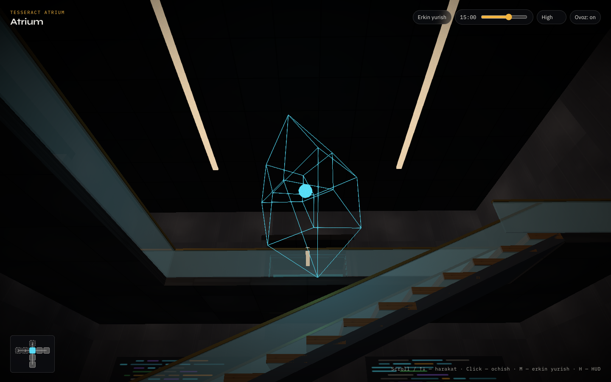
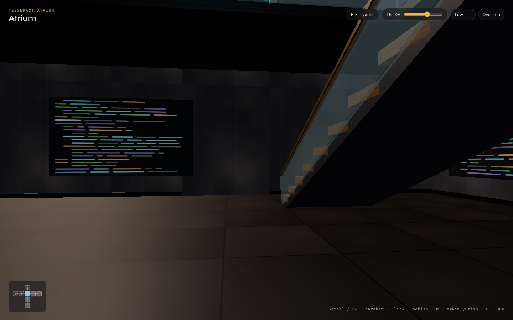
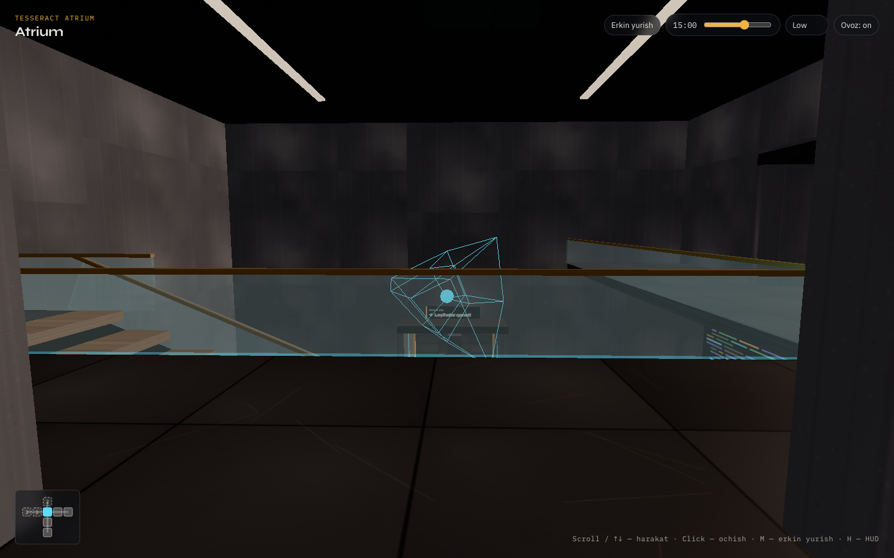
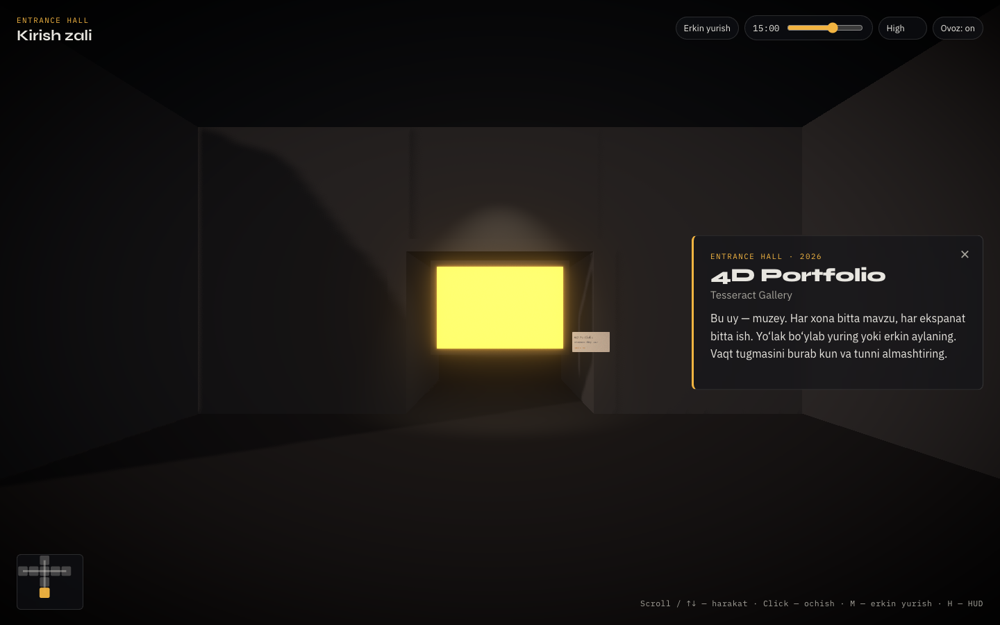
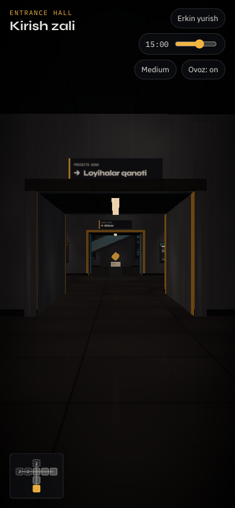

# 4D Museum Portfolio

**A portfolio you walk through: a two-storey 3D museum where every project is an exhibit.**

### [Live demo: 4d-portfolio.vercel.app](https://4d-portfolio.vercel.app)


<p align="center">
  
  <br>
  <sub>The atrium: a tesseract rotating in four dimensions above the glass stair that leads to the upper floor.</sub>
</p>

Instead of a scrolling page of cards, the site is a building. You are guided through it on a camera rail, or you step off the rail and walk it yourself with real collision physics. Projects hang on the walls of the Projects Wing, technologies get a wall of their own, the timeline runs along the upper floor, and the gift shop at the end holds the CV, a bookshelf and a contact card.

## What's inside

**Eight rooms on two floors.** Entrance Hall, Projects Wing, Atrium, Skills Lab and Gift Shop on the ground floor; Experiments, Timeline Corridor and About me on the upper floor. A glass stair and mezzanine in the atrium connect the floors. Every exhibit is an entry in `src/data/exhibits.ts`: add an entry and it appears on the wall.

**Two ways to move**
- **Guided rail** (default): a camera glides along a curated route through the building. Scroll, arrow keys or a finger drag move you along it.
- **Free walk**: first-person movement with collisions, jumping and running.
- Switch at any time with `M`. Pressing `Esc` steps you back out of the museum one level at a time (free walk, then rail, then the start of the route, then the front page).

| | Guided rail | Free walk |
|---|---|---|
| Desktop | Scroll / `↑` `↓` to move, click an exhibit to open it | `WASD` or arrows, mouse to look, `Space` jump, `Shift` run, `E` or click to interact, `Esc` to back out |
| Mobile | Drag to move, tap an exhibit | Joystick on the left, drag on the right half to look |
| Anywhere | Click the mini-map to teleport to a room, drag the time dial, `H` hides the HUD, `Esc` closes a panel, `Shift`+`X` opens the bug report | |

**Things to find**
- **The tesseract** in the atrium: a 4D hypercube, rotated in four dimensions and projected to 3D every frame, with a textured Earth globe turning nearby.
- **Time of day.** A slider in the HUD moves the sun; the same room looks different at 15:00 and at 02:00.
- **Four languages**, chosen at a kiosk in the entrance: Uzbek (Latin), Uzbek (Cyrillic), Russian, English.
- **Live GitHub walls** in the About room: the profile, the repository list and the rendered profile README are painted onto in-world screens.
- **A feedback form on a wall.** Contact card, name, surname and message are drawn into a texture and typed into in 3D; it is delivered to the author through a serverless function.
- **Bug report** (`Shift`+`X` or the HUD chip): captures a screenshot of the scene plus your description and sends both.
- **A like button** in the HUD and **visit counters** on the quick-travel board in the entrance (total visits, and per-room entries).
- **A quick-travel board**, a wall of technology logos, a code gallery, a framed CV with a download button, and a bookshelf of programming books in the gift shop.
- **Animated walls**: each room carries a procedural pattern (neural, circuit, rain or grid) in its walls.

<table>
  <tr>
    <td width="50%"><br><sub>Code gallery and glass staircase in the atrium.</sub></td>
    <td width="50%"><br><sub>The upper-floor mezzanine, looking back at the tesseract through glass.</sub></td>
  </tr>
  <tr>
    <td width="50%"><br><sub>Click an exhibit and an HTML panel opens with the full text.</sub></td>
    <td width="50%"><br><sub>The same museum on a phone.</sub></td>
  </tr>
</table>

<sub>Screenshots come from development builds, so the live site can look slightly different.</sub>

## Under the hood

- **GitHub data comes from a build-time snapshot, not live API calls.** Anonymous GitHub requests are limited to 60 per hour per IP, and a few reloads would blank both wall screens. `scripts/fetch-github.mjs` runs first in `pnpm build`, writes `public/github-snapshot.json` and filters out private repositories; a failed fetch keeps the committed file instead of failing the build. At runtime `src/lib/github.ts` reads memory, then localStorage (6 hours), then the snapshot, then refreshes opportunistically in the background. The screens label their data as `live`, `cache` or `build`.
- **The profile README is parsed inertly and painted, not embedded.** `src/lib/ghpaint.ts` parses the API-rendered HTML with `DOMParser` into blocks, fetches images with CORS (decoding GitHub's camo proxy URLs and rasterising SVGs), and draws everything into a canvas texture on a plain mesh. The wall gets a real depth test, fog and lighting, which DOM overlays would not.
- **The Telegram bot token never reaches the browser.** `api/feedback.js` is a Vercel serverless function that relays the 3D form and bug reports (including the screenshot) to Telegram. It accepts requests only from an origin allowlist (the site itself, optional extras from `FEEDBACK_ALLOWED_ORIGINS`, the deployment's own Vercel URLs), requires JSON, validates field types, applies a best-effort per-IP rate limit, validates lengths, escapes HTML, and caps the photo size. The `Origin` check stops other websites, not scripted clients. The token lives in server-side environment variables; `pnpm test:feedback` drives the function with mocked requests.
- **The rail camera follows a Catmull-Rom curve.** `src/lib/rail.ts` builds a centripetal `CatmullRomCurve3` through the waypoints in `src/data/rooms.ts` and maps scroll to arc length.
- **The tesseract is real 4D math.** `src/lib/tesseract.ts` defines the 16 vertices and 32 edges, rotates them in 4D planes and projects them to 3D every frame into a single preallocated buffer (`src/scene/Tesseract.tsx`).
- **Quality tiers and a fixed performance budget.** `src/lib/quality.ts` picks low, medium or high from device hints and gates post-processing, antialiasing and the reflective floor; resolution is deliberately never changed mid-session, because that rebuilds framebuffers.
- **Performance work that is written down as rules.** Shared geometry and cached, size-quantised materials (`src/lib/geo.ts`); a fixed pool of six spotlights re-aimed per room (`src/scene/SpotPool.tsx`) because adding a light at runtime recompiles every material; `forceSinglePass` on double-sided transparent materials; hover drawn as a moving mesh instead of repainting a 2048x1024 board texture. The reasoning for each is in the engineering notes in the repository root.
- **Bundle splitting under Vite 8 (Rolldown).** Rapier and the joystick library load lazily and only for walk mode, post-processing loads separately, and hand-written chunk groups were removed after they broke the production bundle. In the last build the eager entry chunk was about 360 kB gzipped and the physics chunk about 853 kB gzipped.
- **Mobile that adapts to how you hold it.** `src/ui/TouchControls.tsx` moves the joystick inboard in landscape and the mini-map out of its way; fullscreen is a HUD chip that hides itself where the API does not exist (iPhone Safari).
- **Visit counters with no secret in the bundle.** `src/lib/counter.ts` uses Abacus, a hosted counter that needs no account or token. The trade-off is stated in the code: the namespace is public, so anyone who finds it can inflate a count. Failures are silent so a counter outage never breaks the museum.

## Quickstart

Requirements: Node.js 22 (what CI uses) and pnpm 10 (the version is pinned by `packageManager`).

```bash
pnpm install
pnpm dev                 # Vite dev server, port 5173
```

Scripts from `package.json`:

| Script | What it does |
|---|---|
| `pnpm dev` | Dev server (`vite --host`) |
| `pnpm build` | Fetch the GitHub snapshot, type-check, build |
| `pnpm preview` | Serve the production build |
| `pnpm typecheck` / `pnpm lint` | `tsc -b` / `oxlint` |
| `pnpm test:feedback` | Exercise the serverless relay with mocks |
| `pnpm test:counter` | Check the visit-counter contract (needs network) |
| `pnpm gh:snapshot` | Refresh `public/github-snapshot.json` |
| `pnpm covers` | Re-fetch the bookshelf covers |
| `pnpm assets:optimize` | Optimise GLB assets with gltf-transform |

`vite.config.ts` serves from `/4D-portfolio/` by default; set `BASE_PATH=/` for a root-level deployment, and always resolve public assets with `asset()` from `src/lib/geo.ts`.

**Environment variables** (names only, see `.env.example`):
`VITE_RENDERER` (`webgl`, default), `VITE_DEBUG`, `VITE_PHYSICS_DEBUG`, `VITE_FEEDBACK_ENDPOINT`. Server side, the relay reads `TG_BOT_TOKEN` and `TG_CHAT_ID`. Never put a token behind a `VITE_` name: those values are inlined into the public bundle.

**Deployment.** The site is built for Vercel (`vercel.json`, a GitHub Actions quality gate in `.github/workflows/deploy-vercel.yml`). Step by step in [`docs/DEPLOY.md`](docs/DEPLOY.md).

## Project structure

```
api/feedback.js          serverless relay: form and bug reports -> Telegram
scripts/                 GitHub snapshot, book covers, GLB optimiser, tests
public/                  snapshot, 2D fallback guide, CV, textures, book covers
docs/                    CONCEPT.md, DEPLOY.md, research notes, screens/
src/
  data/                  rooms.ts (floor plan, rail waypoints), exhibits.ts (content)
  lib/                   rail, tesseract, quality, github, ghpaint, counter, i18n, procedural textures
  state/store.ts         zustand store (phase, mode, room, language, time of day)
  scene/                 Experience (canvas), World, rooms/, player/, physics/, wall screens, exhibits
  ui/                    EnterGate, Hud, MiniMap, InspectPanel, TouchControls, BugReport
```

More background: [`docs/CONCEPT.md`](docs/CONCEPT.md) (the design concept, in Uzbek), [`docs/research/`](docs/research/) (the research behind it) and the engineering notes and conventions in the repository root.

## Credits and assets

- **Earth textures** in `public/textures/planets/` are the planet textures from the three.js examples.
- **Book covers** in `public/books/` were fetched once from Open Library by `scripts/fetch-covers.mjs`. The books belong to their authors and publishers; the shelf links to official pages and hands out no files.
- **Technology logos** are loaded at runtime from devicon and simple-icons. They are trademarks of their respective owners.
- **Fonts** (Sora, IBM Plex Sans, IBM Plex Mono) are loaded from Google Fonts.
- **GitHub data** (profile, repositories, README) is fetched from the public GitHub API.
- **Visit counts** use the Abacus counter service.
- The libraries are listed in `package.json`; most visuals (surfaces, posters, code plates) are generated procedurally in code.

This repository is published for reference and learning. No license is granted. The CV, portrait, contact details and project descriptions are the author's personal content.

## Qisqacha (O'zbekcha)

Bu — aylanib yuriladigan 3D portfolio: ikki qavatli muzey, har bir loyiha esa bitta eksponat. Ekskursiya rejimida kamera sizni yo'lak bo'ylab olib yuradi, erkin yurish rejimida (`M`) esa o'zingiz kezasiz. Atriumda 4 o'lchamli tesserakt aylanadi, kun va tunni almashtirish mumkin, interfeys to'rt tilda. Jonli sahifa: https://4d-portfolio.vercel.app. Kodni ishga tushirish uchun `pnpm install` va `pnpm dev` yetarli; deploy bo'yicha qo'llanma `docs/DEPLOY.md` faylida.
